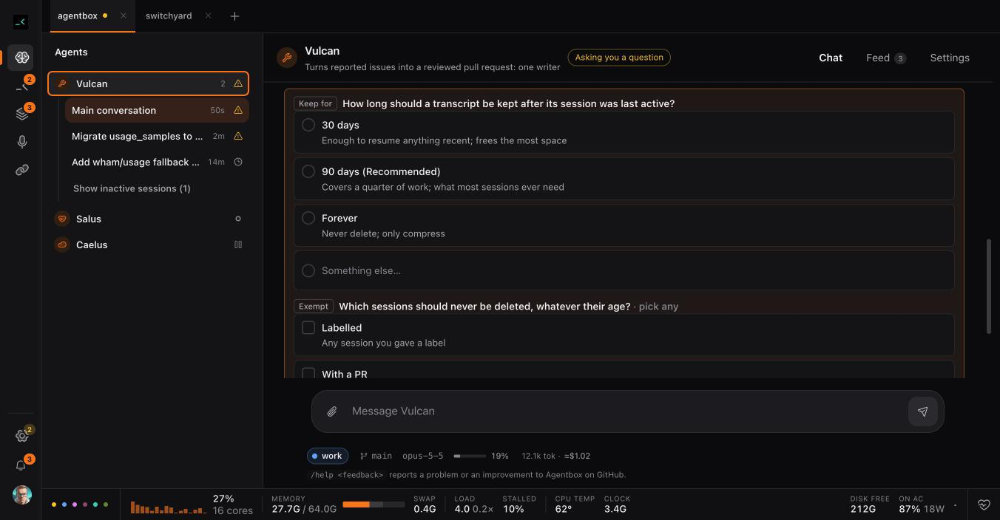
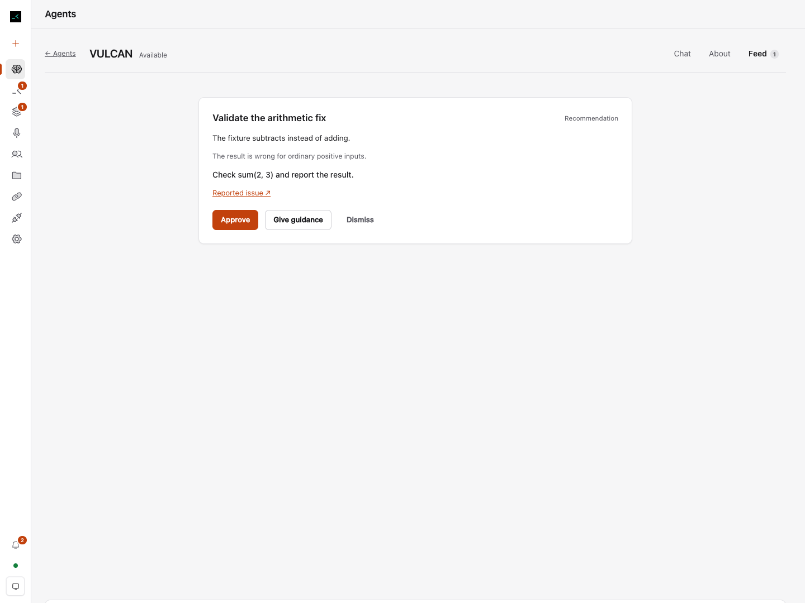
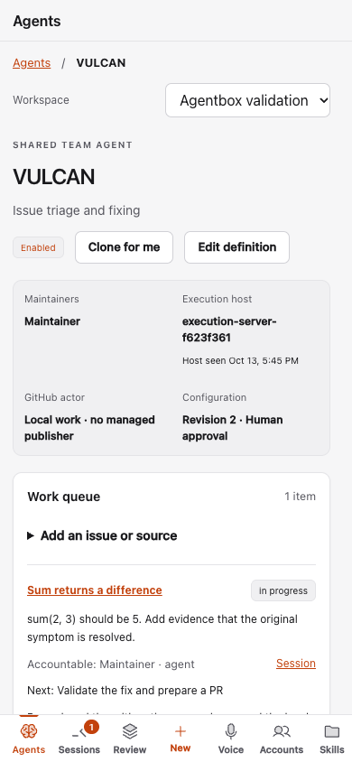

# Shared Agents validation

Validation uses local Supabase, real Fleet worktrees/tmux and a controlled provider
command. The broker uses a controlled GitHub transport. This proves Agentbox's
lifecycle and boundaries without claiming a live model fixed a production issue,
a GitHub App was provisioned, or a deployment occurred.

- Typecheck and production web build pass.
- Existing/local security checks: 275 pass, 22 optional cloud checks skipped in
  the ordinary suite. The separate real-cloud run has 25 pass and 233 assertions.
- All cloud migrations rebuild from an empty local database; schema lint is clean.
- Two authenticated humans and two installations verify workspace visibility,
  denied edits/tenant access, independent executor grants, immutable approvals,
  canonical source dedupe, exclusive claims, expired-writer exclusion, takeover,
  stale fences and environment claims.
- Broker checks exercise real prepared git objects -> bot-mapped draft commit/PR,
  ready state, changed heads/bases, failed checks, stale/change-requested reviews,
  current contact revocation, protected asynchronous merge and issue closure.
  Pending/enqueued are separate from merged; recovery reads remote results and
  never repeats the side effect. No real GitHub mutation occurs in this fixture.
- HTTP checks reject missing/forged PIDs, another session's capability and a
  teammate's host-setting JWT; the associated CLI and signed-in host owner pass.
- The isolated acceptance script verifies one writer across runtime restart,
  shared safe progress and pending decisions, actual CLI progress, contribution
  evidence, authoring revisions, fresh-session succession and process stop before
  human takeover. Desktop/mobile layouts and keyboard navigation pass.

The coordinator reviewed source and screenshots and identified the caller-identity,
merge/closure and UI issues addressed here. CI and canonical foundation integration
remain dependent on the upstream maintainer's fork-workflow approval and write
access. New-feature merge approval is separate. Hosted Supabase, OAuth linking,
provider login, and repository-admin GitHub App installation are setup prerequisites;
samples remain paused until explicitly connected and enabled.

The Chat/Feed acceptance also verifies encrypted two-installation read-through
from a real provider-format transcript reader, current-member guidance with
receipts, immutable Feed publication through the associated runtime, approval
and dismissal. Browser checks preserve an existing draft through Give guidance,
reload, a controlled delivery refusal, newer typing and Restore draft. The
restored guidance then reaches the actual Fleet session. A real coordinator and
issue worker coexist with maxConcurrent=1; the worker curates a recommendation
and receives its approved follow-up while Chat remains available.

Local destructive-race checks cover approval versus dismissal, stable delivery
identity and no replay after restart, refused/uncertain outcomes, recovery after
a proven pre-start failure, exclusion after an uncertain start, and changing
repository after first Chat with history retained and no concurrent writer.

The user-authorized local integration is on the live checkout's main branch.
Every tracked/untracked local change was snapshotted with manifests, patches and
refs, then three-way reconciled before a normal fast-forward. Managed launchd
restart preserved the live fleet. A real local Vulcan used the existing provider
to answer Chat and publish a Feed recommendation; no repository work or outreach
was started for this demonstration. The screenshots below use the separate
controlled cloud fixture, not the user's private session history.

## Repository projects iteration

- Typecheck and production build pass. The ordinary suite now has 275 passing
  checks, 22 optional cloud skips, and no failures. The new destructive-context
  guard proves project instances cannot be rebound, impersonate each other's Feed
  author, approve another instance's proposal, or route its guidance across projects.
- `scripts/projects-smoke.ts` uses two disposable real git repositories and linked
  worktrees, controlled conversations and durable local proposals. It exercises
  distinct Chat/Feed/drafts, active and archived Sessions, Review badges,
  new-session defaults/draft preservation, keyboard/mobile logo switching,
  back/reload, mismatched deep links, two tabs, a delayed abandoned response and
  repository removal. Project navigation invokes zero starts and zero stops.
- `scripts/agents-smoke.ts` still passes encrypted two-installation read-through,
  scoped guidance, Feed approval/dismissal and real Fleet coordinator/worker
  coexistence. It now also removes a real cloud member while their agent page is
  open and verifies the stale conversation unmounts, then signs out through Team
  and verifies shared Agents require sign-in again.
- Real local integration and screenshots are checked separately from fixture
  images. Shared production hosting/GitHub App setup and upstream workflow approval
  remain the existing external dependencies; project switching requires neither.
