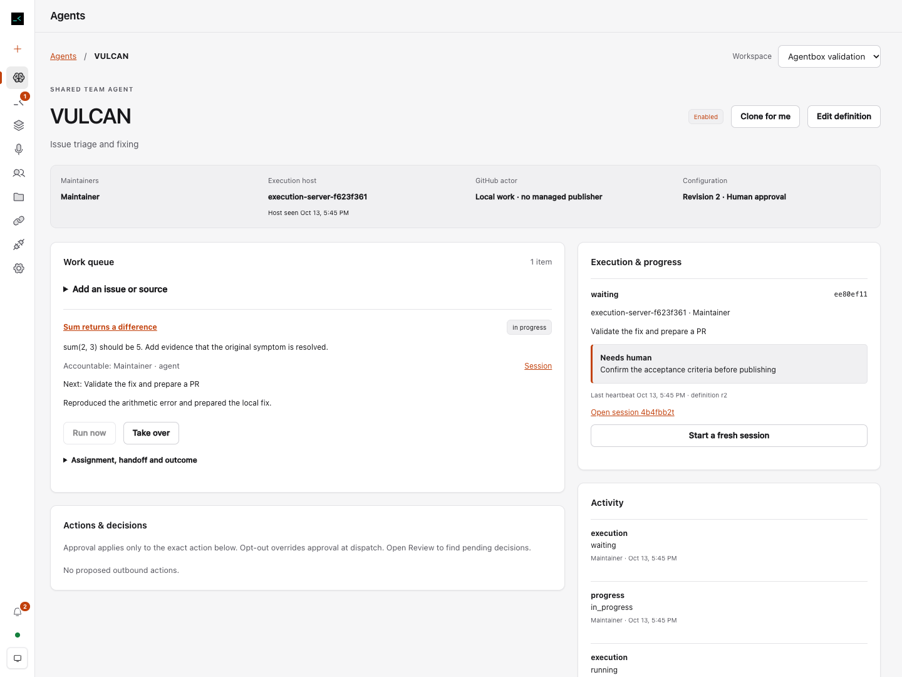

# Shared Agents validation

Validation uses local Supabase, real Fleet worktrees/tmux and a controlled provider
command. The broker uses a controlled GitHub transport. This proves Agentbox's
lifecycle and boundaries without claiming a live model fixed a production issue,
a GitHub App was provisioned, or a deployment occurred.

- Typecheck and production web build pass.
- Existing/local security checks: 266 pass, 20 optional cloud checks skipped in
  the ordinary suite. The separate real-cloud run has 22 pass and 200 assertions.
- All cloud migrations rebuild from an empty local database; schema lint is clean.
- Two authenticated humans and two installations verify workspace visibility,
  denied edits/tenant access, independent executor grants, immutable approvals,
  canonical source dedupe, exclusive claims, expired-writer exclusion, takeover,
  stale fences and environment claims.
- Broker checks exercise real prepared git objects -> bot-mapped draft commit/PR,
  ready state, changed heads/bases, failed checks, stale/change-requested reviews,
  current contact revocation, protected asynchronous merge and issue closure.
  Pending/enqueued are separate from merged; recovery reads remote results and
  never repeats the side effect. No real GitHub mutation occurs in this fixture.
- HTTP checks reject missing/forged PIDs, another session's capability and a
  teammate's host-setting JWT; the associated CLI and signed-in host owner pass.
- The isolated acceptance script verifies one writer across runtime restart,
  shared safe progress and pending decisions, actual CLI progress, contribution
  evidence, authoring revisions, fresh-session succession and process stop before
  human takeover. Desktop/mobile layouts and keyboard navigation pass.

The coordinator reviewed source and screenshots and identified the caller-identity,
merge/closure and UI issues addressed here. CI and canonical foundation integration
remain dependent on the upstream maintainer's fork-workflow approval and write
access. New-feature merge approval is separate. Hosted Supabase, OAuth linking,
provider login, and repository-admin GitHub App installation are setup prerequisites;
samples remain paused until explicitly connected and enabled.

