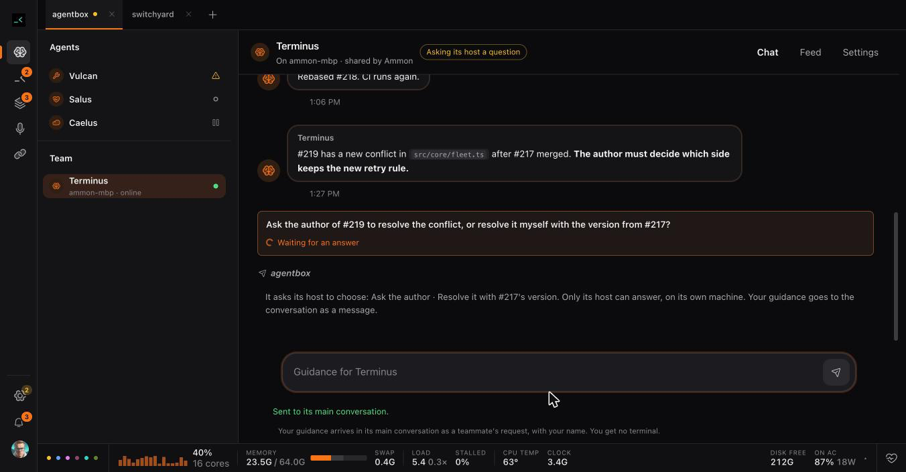

# Agents

An agent on the Agents page is a superagent: a directory that a person owns,
with a manifest (`superagent.json`), standing instructions (`MAIN.md`) and,
when it needs one, a program. Agentbox gives it a main conversation, a page,
a picture and the services its manifest turns on. Agentbox's code names no
agent: Vulcan, Jupiter, Steward, Caelus and Salus are examples in
`superagents/`, and your own agents live in your own directories or git
repositories. [superagents.md](superagents.md) is the contract a program is
written against; this page is how you use them.

## Add an agent

1. Copy an example (`superagents/<name>/`) or write a directory of your own.
   Jupiter writes one from a conversation.
2. Run `agentbox superagent add <dir>`. Run it again after you change the
   manifest.
3. Open **Agents**. The agent is in the rail. Nothing starts until you send
   its first message.

A directory can be a copy that runs an example's code: its manifest's `run`
names the example's `main.ts` by its full path, and the program reads the
manifest in its own directory. Instructions say `{{name}}` where they need
the agent's name, so a copy needs no edit. Two copies of one agent under two
names (`vulcan-agentbox`, `vulcan-plaibook-dev`) are two agents with their
own conversations, memory and state.

## The Agents page

- **The rail** lists the agents of the selected project tab: each agent whose
  manifest names that project (`projects`, or `main.start.repoId`), and each
  agent that names none. With no project selected, it lists all. Each row has
  the agent's picture, its activity, and its conversations under it when it is
  selected. Drag a row to put it where you want it, or use Alt+↑/↓. A
  disabled agent is always last.
- **The header** has the agent's picture, title and status, and three tabs:
  Chat, Feed and Settings.
- **Chat** is the agent's main conversation. Before the first message there
  is a box; your message starts the main from the manifest's `main.start`,
  with its instructions first. After that, Chat is that session's messages
  and its composer. A question the agent asks with a question tool (Claude's
  AskUserQuestion) is a card at the end of Chat: pick an option or type your
  answer, and agentbox answers the dialog in the session's terminal. Earlier
  main conversations stay in the rail, read-only.
- **Feed** is the agent's own page: the blocks its program answers with
  (lists, forms, buttons, its tabs and their badges), and what each daily sweep
  closed and kept. An agent without a program has only the sweeps.
- **Settings** says what the agent is and where its directory is. It has the
  Enabled switch, the program's state, Restart and its output, the provider
  of its main and why, its loops, its sweep time, its picture, and its memory.

A session of an agent that stops on a question, or asks you to decide, is
pushed to your phone like any session, unless its program started it with
`notify: false`.

The sessions an agent starts under its main (a Vulcan writer, a Steward
owner) are its work sessions. They show under the agent, not on the Sessions
page. Opening the page starts and stops nothing.

## Memory and fresh conversations

With `"memory": true`, agentbox keeps a memory journal for the agent in its
home (`<agentbox home>/superagents/<name>/memory.db`):

- **Preferences**: what you want, kept until you change them. Set one in
  Settings → Memory, or the agent sets one when you state it.
- **Decisions**: the agent records one when it makes it
  (`agentbox superagent memory <name> note`).
- **Handoffs**: short summaries a conversation writes for the next one.

`MEMORY.md` in the same home is a read-only view of the journal that agentbox
rebuilds after each write. Agentbox sets an edited copy aside and uses
nothing in it. Memory is evidence for continuity, never approval; the
provider transcripts stay the record.

`SOUL.md` in the agent's directory is its persona, voice and boundaries. You
write it, with the rest of the directory. Each fresh main conversation reads
it after `MAIN.md`: up to 4,000 characters, in whole lines, and nothing at all
when it holds credential-shaped text. Agentbox never writes it.

With `"main": {"rollover": {"idleMin": 10, "contextPct": 60}}` (or `true` for
these values), the main conversation continues in a fresh session when it
would be expensive to keep:

1. When you have been away `idleMin` minutes and its prompt cache is still
   warm, agentbox asks it for a handoff of about 500 words.
2. A later message that finds the conversation cold, or more than
   `contextPct` full, starts a fresh main from that handoff, your preferences,
   the recent decisions and the live state it takes over (waits, Review cards,
   PRs, the sessions it started). Chat follows it.
3. A missing handoff, or one older than the last real message, leaves the
   message with the old conversation. Nothing is dropped.

The fresh main gets the old one's waits, cards, PR claims, work claims and
sessions through the same handover a program asks for (`agentbox handover`).

## Loops

A loop says a prompt to the agent's main conversation on a schedule, after
its current turn ends, whichever session the main is now. Put loops in the
manifest (`"main": {"loops": [{"id": "hourly", "when": "every hour", "check":
"<command>", "prompt": "…"}]}`), or set one at run time:

    agentbox superagent loop <name> set <id> --when "every hour" [--check <command>] --file <prompt file>
    agentbox superagent loop <name> rm <id>

The check runs first: exit 0 says the prompt with what the check printed,
exit 1 skips this time, any other exit is a failure that the agent's Settings
shows. A time that comes while the main is busy waits for its turn to end.

## The daily sweep

With `"sweep": "23:00"` (or `true` for the time in agentbox's Settings),
agentbox closes the agent's work sessions that have been idle for two hours,
each day at that time. Closed is the board's close: the transcript stays and a
message resumes it. A session that still holds a wait, an open Review card, a
claimed PR or a child at work is kept, and the Feed says why. A main
conversation is never closed this way.

## The provider

`"provider": "auto"` in `main.start` (or on any `POST /api/sessions`) starts
the conversation on Claude or Codex, whichever has room, by Codex's weekly
limit: Codex first above 50% left, Claude first below 10%. A warm
conversation keeps its account; a rollover past `contextPct` chooses again for
the fresh one. Settings says which provider the main runs on and
why.

## Ready pull requests

An agent with `"events": ["pr.ready"]` gets each pull request that a session
reports ready (`agentbox pr ready <PR> --head <SHA>`), once per PR and head,
when it shows in the PR's project. An agent with a program gets it as the
action `pr.ready`; one without gets it in its main conversation.

## Team agents

A team agent runs on one machine, the host, and its team sees it from theirs.
The host's owner shares it with a cloud workspace from its Settings. The
cloud then holds a record of the instance: its name, title, the git source of
its directory, its maintainers and its visibility. It never holds the
agent's code: a teammate who wants their own copy takes the directory from
git. A teammate reads the agent's Chat and page, and uses its actions,
through the encrypted live relay; a session reference never gives a
terminal. The claims of a shared agent are kept in the cloud, so two hosts
never work the same item. [cloud.md](cloud.md) is the contract.

A program that publishes to GitHub asks agentbox's GitHub App broker for each
action (`POST /api/github/actions`). The host's owner pins the App policy the
manifest proposes; the broker checks the policy, the App's identity, the
repository, a claim's fence and each person's consent before it acts, and
its tokens never reach the program ([superagents.md](superagents.md), GitHub
actions).

## From the old in-core agents

Agentbox once had its agents in its own code. `scripts/migrate-local-agents.ts`
moves each of them that has something to keep — a conversation, memory
records, a loop, a picture, a SOUL.md with text — into a directory in
`~/.agents/superagents/`, named after the agent and its project
(`vulcan-plaibook-dev`); an agent of no project shows only under All
projects, as before. It keeps the conversation as the agent's main, the
earlier ones, the loop, the picture and the provider choice, and copies the
memory journal record by record. It moves each agent once and never writes
over a directory it did not write. The script names no agent; you say what
each becomes:

    bun scripts/migrate-local-agents.ts --dry-run \
      --template vulcan=superagents/vulcan --template jupiter=superagents/jupiter \
      --events terminus=pr.ready

An old agent's id still reaches the agent it became, so its conversation's
old commands (`agentbox agent memory local-… note`, `agentbox agent loop …`)
keep working.
